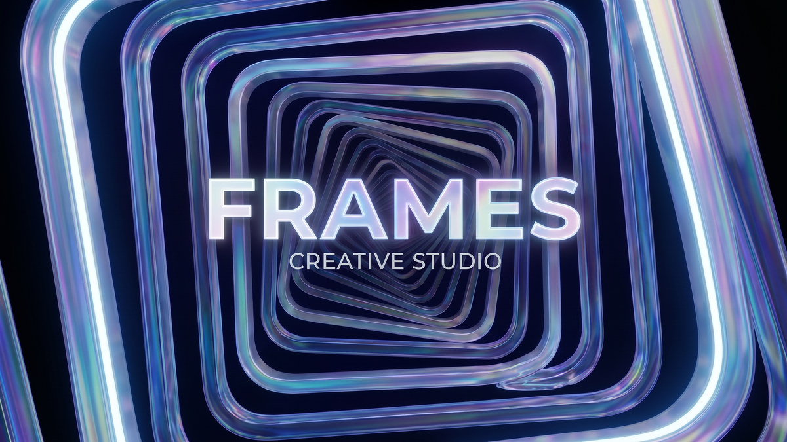

  

<h1 align="center">Frames</h1>

<strong>Frame-based VFX + AI-gen compositor.</strong>

  Drop media on a board. Grade, key, matte and comp it in-app, generate with ComfyUI or cloud models,
  review with your team in ShotGrid — or just tell the built-in assistant what you want set up.

---

## What Frames is

Frames is a desktop studio for VFX artists: a board you drop media onto, **frames** that hold a shot's work, and native compositing tools that run in the app — plus ComfyUI templates (local or on a RunPod GPU) and cloud generation models when you need AI.

- **An assistant that operates the app.** Describe a change or a whole workflow in plain words ("make an Inpaint widget for each selected image", "mask the people in the video and run it") and it builds it on the board with the app's own functions, asking only before anything that costs money or deletes. Use a local model with Ollama and nothing leaves your machine. **Shift+Tab** anywhere — see [The assistant](#the-assistant).
- **Talk instead of type.** Hold **Alt+Shift** anywhere, say what you want, let go: it is transcribed on your own machine (your GPU on Windows, Apple's on-device speech on a Mac) and sent to the assistant.
- **Frames on your phone.** Pair a phone by QR code and drive the studio from its browser — nothing to install: the assistant, every widget's settings and Run, board media, live outputs and status. At home on Wi-Fi, or from anywhere with Tailscale. See [Frames on your phone](#frames-on-your-phone).
- **Native frames, no node wiring.** Merge, Color, Blur, Keyer, Despill, Transform, Retime, Regrain and Invert run in-app in float, preview live, and bake masters (ProRes / EXR / HEVC).
- **ComfyUI templates as forms.** Templates declare their inputs; Frames builds the settings form. Drop media into slots, hit Run.
- **Cloud generation built in.** Google Vertex (Nano Banana, Veo, Omni), FAL (Seedance, Kling, MiniMax, Wan…), Beeble, Topaz and BytePlus from one widget.
- **A built-in manual.** **F1** opens the page for whatever you're looking at: the selected widget, the native frame, or the panel you're on.
- **Lineage by default.** Every output knows which inputs and settings produced it.
- **RunPod without the website.** Deploy a GPU pod from a wizard (hardware, storage, software, your Hugging Face token — all set for you), see your balance and every pod live, and let pods stop themselves when the GPU sits idle.
- **Production tie-in.** Track your time, map it to ShotGrid tasks, review versions with frame annotations, and post notes to artists — without leaving the app.
- **Readable on any screen.** Text size, interface zoom and six colour themes (plus your own) in Settings → Appearance.

---

## Install

> Frames is currently in **closed beta**. Activation requires approval — see [Activate](#activate).

### Windows

Download the latest `Frames-Setup-X.Y.Z.exe` from the [Releases page](https://github.com/richservo/frames-releases/releases/latest) and run it.

- Installs per-user under `%LOCALAPPDATA%\Programs\Frames` (folder can be changed). No admin rights needed.
- The installer is small (~120 MB). The Python runtime that powers the local AI tools is set up on **first launch** (see below), not during install.
- The installer is not code-signed yet — Windows SmartScreen will warn on first run. Click **More info → Run anyway**.

### First launch: runtime setup

After activation, the **Setting up Frames** screen installs the Python runtime once (several GB):

1. **Location** — default `%LOCALAPPDATA%\Frames\runtime`, or pick another drive with **Change…** (handy to keep large files off C:).
2. **Hardware** (Windows) — **NVIDIA GPU (CUDA)** or **CPU only**. The detected option is marked.
3. **Install** — progress streams live. Later app updates only download what changed.

The runtime also installs **ffmpeg** and, on Windows, the **speech-to-text model** (Whisper large-v3-turbo, about 1.6 GB, for push-to-talk); both are checked on every launch and reinstalled if missing. Other model weights download separately the first time you use each feature. The runtime can be moved later from **Settings → Python runtime**.

### macOS (Apple Silicon)

Download the latest `Frames-X.Y.Z-arm64.dmg` from the [Releases page](https://github.com/richservo/frames-releases/releases/latest), open it and drag **Frames** to **Applications**.

- Needs an **Apple Silicon Mac** (M1 or later) on **macOS 26 or later**.
- Signed with a Developer ID and notarized by Apple, so it opens normally - no security warnings.
- The first launch sets up a smaller runtime than on Windows (about 660 MB: ffmpeg and the Python tools that run on the CPU).
- **Push-to-talk** uses Apple's on-device speech recognition; macOS asks for microphone and speech access the first time.

**The AI tools run on a RunPod pod.** A Mac has no NVIDIA GPU, so every tool that needs one runs on your focused pod instead: SAM3, MatAnyone, ViTMatte, the Rotoscope and Surface trackers, the 3D Camera solve, motion flow and retime, and Local Generate Media. Connect a pod in the **Connection** panel and they work as usual - your clips upload once and results come back into your library. The first run on a pod installs the tools there (a few minutes, shown in **Transfers**); deploy with a **network volume** so it stays installed for your next pods. RollingDepth and Pose have no pod version yet, so they are not available on a Mac. Everything else - the board, native frames (Merge, Color, Blur, Keyer...), the viewers, exports, cloud models and the assistant - runs on the Mac itself. The same applies to a Windows PC without an NVIDIA GPU.

---

## Activate

First launch shows the activation screen.

### Request access (closed beta)

1. Enter your full name, email and mailing address, then **Request access**.
2. The screen shows "Request submitted" and checks for approval every few seconds. You can close the app — the next launch picks up where it left off.
3. Once approved, the license applies automatically and the app opens.

Your details are encrypted in transit and used only to issue and support your license.

### Already have a .rslicense file

Click **I have a .rslicense file already → Choose .rslicense file…**. It's verified and stored in your user data.

The **Machine ID** at the bottom of the screen (with a copy button) is what support may ask for.

---

## Quick start

1. **Open Studio** — click **Studio** in the left nav. The canvas is the big empty space.
2. **Drop media** — drag videos, images or image sequences from your desktop onto the canvas.
3. **Add a frame** — press **Tab** for the widget palette, or use the Alt shortcuts (e.g. **Alt+C** Color, **Alt+K** Keyer, **Alt+F** a ComfyUI Frame around your selection).
4. **Wire it** — drag a media card into the frame's input; tweak it live in the frame's viewer.
5. **Run output** — bakes a master to the library (and to the board's output folder if set).

Or press **Shift+Tab** and ask the assistant to do any of it. **F1** opens the manual at the page for what you're working on.

To run ComfyUI templates, add a connection first (see [Connection](#connection)) — local ComfyUI or a RunPod pod.

---

## The assistant

Frames has an assistant built in that **operates the app for you**. Press **Shift+Tab** anywhere and type what you want, in plain words — from one change to a whole workflow. It works out the steps and carries them out with the app's own functions, live on your board. Every change can be undone.

**Talk to it.** Hold **Alt+Shift** anywhere in Frames and speak; let go and it is transcribed and sent — the assistant opens if it was closed. Speech is turned into text locally (Whisper on Windows, installed with the runtime; Apple's on-device speech on a Mac), so your voice never leaves the computer. Another key while holding cancels it.

**Things you can ask it:**

- "Make an Inpaint widget for each selected image, and lay them out so nothing overlaps."
- "Make a SAM3 mask from the video with the prompt *people* and run it." — no selection needed; it finds the video.
- "Use the SAM3 mask as the MatAnyone hint."
- "Mask the traffic light in the Inpaint and turn it green." — it finds the subject, SAM3 cuts the mask, it writes the prompt, and shows you the mask before running.
- "Paint the sign bright green and remove it" · "Draw a red circle around the lamp." — it uses Inpaint's Color brush, Square and Circle.
- "Keep the person in front of layer 2 visible." — it edits an existing layer's mask (cut a subject out, widen, erase, fill).
- "Mask the cyclist in the Rotoscope." — SAM3 follows the subject through the clip and adds it as a mask layer; "mask out" makes it a subtracting occluder the tracker ignores.
- "Track the crutches." — it draws editable roto splines (anchors and handles, like the pen) fitted to SAM3's outline of the subject, then runs the track; if SAM3 can't cut it, it traces the shape itself and snaps it to the edges.
- "Bring in the plate from shot 5840's bin." — it finds the other shot's media, bins or outputs and puts them on your board, without leaving it.
- "Make still frames from the video at 0, 25, 32 and 51."
- "Save all the Inpaint outputs to the output folder as Paint_Frame<frame number>." — it reads the frame from each source's name.
- "Resize all of these to 1920 wide."
- "Make a new board for shot 12 under the KOI project and bring in the plates."
- "Spin up an RTX 6000 with 300 GB and no Ollama." — if it isn't in stock, it says so and lists comparable cards.
- "What's my RunPod balance?" · "Stop the training pod."
- "Why did that run fail?" — it reads the actual errors and logs before answering.
- "How does the Keyer work?" — it answers from the manual and links the page.

**How it behaves**

- **It can do anything the app can.** Boards and projects, every widget and frame, any setting, connections between widgets, runs, media operations in batches, canvas layout, pods and RunPod, storage, ComfyUI templates, Time and ShotGrid. Anything without a dedicated action it reaches through the interface itself — pressing buttons and setting controls the way you would, including answering Save / Open dialogs.
- **It asks first** only before something that costs money (a paid-service run, deploying or starting a pod) and before anything that deletes or stops work. Local runs and runs on a pod you already have running just start. **Reckless mode** (the toggle in the assistant's title bar, with a cost warning) lets it spend without asking; the window is outlined in red while it's on, and deleting still always asks.
- **You see it work** — a status line with a clock, the model's thinking, the reply as it streams, and one card per action with **Undo**.
- **It learns how you work.** What it had to look up, the way you set things up and your preferences are kept as memory, so a repeat request is one recall, not a lookup. It tidies that memory itself now and then (overlapping entries folded into one); see or edit it in **Settings → Assistant memory**.
- **Your own model.** It uses the board's Prompt Enhancer backend (Gemini, Claude, an OpenAI-compatible endpoint, or Ollama) and the board's allowed credentials. One conversation per board, kept with that board even when it opens another.
- **Private if you want it.** Point it at a local model with **Ollama** and the assistant runs entirely on your computer — your prompts, your board and your files never leave your machine. (Ollama on your own pod keeps it on hardware you control.)

---

## Frames on your phone

Use Frames from a phone's browser (Android or iPhone, nothing to install) while the studio runs at home.

**Set up once:** **Settings → Remote → Turn on**, then **Pair a device…** and scan the QR code with the phone's camera. The first time, allow Frames through the Windows firewall on private networks.

- **At home:** the phone on the same Wi-Fi (pick the **Home network** QR).
- **From anywhere:** install **Tailscale** on the computer and the phone, signed in to the same account, and pick the **Tailscale** QR. Frames is reached only over your home network and Tailscale — it never opens itself to the internet.

**On the phone:**

- **Assistant** — the same conversation as the desktop: send messages (your keyboard's dictation mic works), **Allow / Decline** runs and deletions, **Stop**.
- **Widgets** — every widget on the board with a thumbnail of what it is controlling, its status, **all of its settings** (the same ones as its desktop panel) and **Run / Stop**. Tap the thumbnail to render its result and step through every output in its rail. **Layers** on an Inpaint card controls its layer rail from the phone — show / hide, opacity, feather, variations, new variation, delete — live on the computer, so the phone works as a second-screen controller.
- **Media** — every card on the board. **Outputs** — everything Frames generates, live, with a notice when something lands or fails. Step through either full screen with the arrows or a swipe.
- **Status** — connections (switch which one you work on), GPU / RAM / disks, transfers and errors.
- **Boards** — tap the board name at the top: the same show / scene tree as the desktop, with search across board names and what is on them.

Each paired phone can be revoked in **Settings → Remote**; a code works once, for one device, for 10 minutes.

---

## Feature reference

### Studio — boards and canvas

An infinite pan/zoom board (middle-mouse / two-finger drag to pan, wheel to zoom).

- **Boards and projects** — the board switcher shows a project tree (Show → Scene → …, any depth). Boards without a project are *Unfiled*. Search by name or content.
- **Board history** — the live board plus five rolling backups, restorable (and the restore is undoable).
- **Board Settings** — per board:
  - **Project** placement in the tree.
  - **Allowed credential profiles** — lock a board to a client's accounts; other profiles are hidden and refused at run time.
  - **Output folder** — where **Run output** delivers masters (the library proxy stays in place).
  - **Output frame rate** and **output colorspace** for rendered masters (Auto follows the source).
  - **ShotGrid time logs** — which ShotGrid task this board's tracked time goes to.
- **Media cards** — images, video and image sequences with trim (in/out marks), retime, resize, and audio.
- **Lineage** — outputs keep a dashed line back to their inputs.

#### Native frames (run in-app, no ComfyUI needed)

| Frame | Shortcut | What it does |
|---|---|---|
| **Merge** | Alt+M | Layer stack compositing (over, screen, multiply…). |
| **Color** | Alt+C | Float grade: exposure, white balance, lift/gamma/gain wheels, contrast, ASC-CDL, saturation, curves, scopes, .cube LUTs. |
| **Blur** | Alt+B | Gaussian, box, disc and bokeh defocus with lens presets; optional mask. |
| **Invert** | Alt+I | Invert a clip or matte. |
| **Transform** | Alt+T | Move / scale / rotate with a gizmo, keyframeable, optional mask. |
| **Despill** | Alt+D | Remove green/blue spill with spill replacement and cast correction. |
| **Keyer** | Alt+K | Chroma key with screen balance, clip black/white and built-in despill. |
| **Regrain** | Alt+G | Re-apply the plate's grain to a comp, per-channel. |
| **Retime** | Alt+R | Keyable speed curve; renders in-betweens with RIFE from the master in float. |
| **Frame** | Alt+F | ComfyUI template container: pick a template, fill its slots, Run. |

Every native frame previews live and has **Run output** to bake a master in the format you pick under **Master** (ProRes 4444 / HEVC 10-bit / EXR), from the source masters at float precision, in the board's output colorspace.

#### Widgets

| Widget | What it does |
|---|---|
| **Generate Media** | Cloud image/video generation. Google Vertex (Nano Banana Pro / 2, Veo 3 / 3.1, Gemini Omni Flash), FAL (Seedance, Kling, MiniMax H3, Wan, GPT Image, Seedream, depth, upscale…), Beeble SwitchX, Topaz (upscale / interpolation), BytePlus Seedance. Reference bin, history rail, @mentions. |
| **Inpaint** | Paint a mask and regenerate just that area as a toggleable layer, with any image model you have credentials for — Google Vertex (Nano Banana Pro / 2) or FAL (Nano Banana, GPT Image, Seedream…). Clone stamp, video timeline, layer groups. |
| **Local Generate Media** | Video generation locally or on a pod: Wan 2.1 / 2.2 VACE, ID-V2V identity restyle, SCAIL-2 character animate / replace, MiniMax-H3 (reference, masked reference, ControlNet, first/last frame, text, face refine, FAST turbo modes, all with audio), **H3 Video → Video** (Viggle Remake swap / edit, with painted frames, pins and a guided prompt form), and LTX-2.5 (text / image, keyframes, IC-LoRA video-to-video incl. community adapters such as Obscura Remova for occlusion removal, audio-to-video). Helpers: Canny lines, RollingDepth video depth, whole-body pose. |
| **SAM3 Mask** | Click points to mask a subject; propagates through video. Runs on your NVIDIA GPU, or on your pod (Mac, or no NVIDIA GPU). |
| **MatAnyone** | Mask-guided video alpha matting (feed it a SAM3 mask). |
| **ViTMatte** | Turn a rough mask into a clean alpha edge (hair, fur, props), with temporal smoothing for video. |
| **Rotoscope** | Animatable bezier shapes with feather; Ctrl+drag snaps points to edges. |
| **Surface Track** | Tracks every pixel of a plate from a hero frame as a deforming mesh, then sticks an element to the surface, exports an STMap, solves rigid pieces and the camera, and exports geometry. Holds up on skin, cloth and folding surfaces. Runs locally. See [Surface Track](#surface-track) below. |
| **3D Camera** | Turn a still + depth into a mesh you can move to find a new camera angle. |
| **Tile Outpaint** | Split a larger canvas into overlapping tiles, generate each, stitch with blending. |
| **LoRA Trainer** | Train Wan 2.2 character / style / object LoRAs on a connected pod, with live loss and samples. |
| **Prompt Enhancer** | Rewrite prompts with Ollama (local or on the pod), an OpenAI-compatible endpoint (RunPod serverless), Claude or Gemini; positive / negative outputs wire into prompt boxes and template slots. Its backend also powers the assistant. |
| **LatLong Rotate** | Rotate 360° equirectangular images, with exposure / HDR range. |
| **Solid** | Solid-color image or video plate. |
| **Note** | Sticky note. |

#### Surface Track

Sticks an element to a deforming surface, such as a patch on skin that stretches, folds and moves.

1. **Plate:** create the widget with a clip selected, or drop one on the Plate zone in its settings.
2. **Track:** scrub to the hero frame and Run **Track**. **Draft** tracks at 720 px in seconds, to check the result. **Final** tracks at full plate resolution, in tiles that follow the surface (several minutes). The **Grid** view shows a test grid stuck to the surface; scrub to judge the track.
3. **Element:** drop an image or clip, lined up with the plate at the hero frame (for example a paint fix). Its linked matte is used as its alpha.
4. **Masks (optional):** drop roto outputs or any matte. **Contain** trusts the track only inside the matte. **Repel** treats it as an occluder: the track under it is filled in from the surrounding surface.
5. **Process** (settings), then Run:
   - **Render element:** the element warped onto the surface, as a 32-bit float EXR with its matte in alpha (premultiplied). It's rendered forward, so a surface that folds over itself stays clean.
   - **Export STMap:** a 32-bit float EXR, R = U and G = V (bottom-up), for an STMap node. An STMap can't represent a surface folding over itself; use Render element for those shots.

Outputs go into the widget's output rail and to the board's Output folder. **Smooth** removes jagged point-to-point noise. **Set origin** makes any frame the identity without re-tracking.

### Manual

**F1** opens the built-in manual (61 pages): getting started, every widget and native frame, every panel, Time, ShotGrid, troubleshooting and the shortcuts. With a widget or native frame selected it opens that page; with nothing selected, the page for the panel you're on. The assistant searches the same manual.

### Time

A passive time tracker: it records what you worked on each day — runs, generations, bakes, imports, edits and time active in the app, per board — with no timers to remember.

- **Range** — Today by default; Yesterday, This week, Last week, This month, or any date range. Past days are rebuilt from your history, so it works retroactively.
- **Project filter** — one project and everything nested under it, for per-client reports.
- **Manual tasks** — Start / Stop named tasks (e.g. "R&D: depth model"), edit times afterwards, add notes.
- **Views** — totals per board and per task, a per-day timeline, and a detailed log of every block.
- **Export** — **PDF** report, **detailed CSV**, or a **ShotGrid CSV** (decimal hours).
- **Push to ShotGrid** — send time logs straight to the mapped ShotGrid tasks, with a preview first. Pushing a day again updates the same time logs instead of duplicating them.

### ShotGrid

Appears in the nav once a ShotGrid site is added in Credentials. A badge shows tasks with unread notes.

- **Modes** — My tasks (all projects), Project tasks, All shots, and Playlists. Sortable columns, text search, filters for task, task status and shot status, **Hide final**, **New notes only**. Filters are remembered per project.
- **Multi-select** — click, Ctrl+click, Shift+click.
- **Task / shot detail** — thumbnail, description, cut range, statuses, dates, bid vs logged, notes with replies and attachments, and every version with playback.
- **New-note alerts** — tasks with notes you haven't read are highlighted and announced, following ShotGrid's own read state.
- **Log time / Start timer / New note** from any task.
- **Upload from the canvas** — right-click a media card → **Upload to ShotGrid…** creates a Version on the task (review copy or master), auto-named as the next version, with your description. Progress shows in the Transfers dock.

#### Playlists and review

- **ShotGrid playlists** — open any project playlist; create new ones; **+ Playlist** on any version.
- **Local playlists** — right-click shots → **Add to local playlist**. Kept in Frames; each shot plays its latest video unless you pin a version; save to ShotGrid any time.
- **Quick playlists** — **Whole sequence** or **Prev / current / next** for any shot, in cut order, skipping omitted shots, using each shot's latest video.
- **Review player** — plays continuously (the next clip loads ahead), thumbnail strip that follows playback, hover a tile to pick another version, × to drop a clip, **Solo** to loop one clip.
- **Frame annotations** — pause, draw (pen with colors, arrow, circle, square, text), and post: the artist gets a ShotGrid note with the exact frames attached, numbered in ShotGrid's frame range. Annotated frames show as diamonds on the playbar; jump between them with **[** / **]**. Text annotations prefill the note.
- **Viewer color** — exposure, gamma, contrast and saturation per clip (view only).

| Review key | Action |
|---|---|
| Space | Play / pause |
| ← / → (or , / .) | Step one frame |
| J / K / L | Reverse / pause / forward (press again for 2×, 4×); hold K + J/L to step |
| ↑ / ↓ | Previous / next clip |
| [ / ] | Previous / next annotated frame |
| S | Solo (loop this clip) |
| Ctrl+Z | Undo annotation |

### Connection

Saved endpoints, stored encrypted:

- **RunPod pods** — deployed from Frames (below); they reconnect on their own, even after a stop/start changes their address.
- **Existing pods / SSH hosts** — paste an SSH line.
- **Local ComfyUI** on this machine (install path + port).

Several can be connected at once; the one you click is *focused* and gets Runs, Files, Resources and the ComfyUI view. Others stay connected so their in-flight runs keep streaming progress.

#### RunPod account

With your RunPod API key (Frames prompts for it, with a link to RunPod's key page), the top of the panel shows:

- **Balance**, what everything running costs per hour, and how long the balance lasts. The same line shows in the Resources dock while a pod runs.
- **Every pod on the account** — status, GPU, region, uptime, $/hr — with **Start**, **Stop**, **Restart** and **Terminate** (terminate asks first). A terminated pod also leaves your Connections list, however it was terminated (here, by idle stop, or on RunPod's site); a stopped pod stays, ready to start again.
- **Alerts** — a popup wherever you are when the balance drops under $10 or under 3 hours of runway, and if RunPod refuses the saved key.
- **Network volumes** — list, create, grow, delete.

Adding credit is the one thing still done on RunPod's site (turn on auto-pay there once and it tops itself up).

#### Deploy a pod (no website)

**+ Add pod → Deploy a new RunPod pod**:

1. **Hardware** — live GPU table: VRAM, $/hr, stock per region; secure cloud (default) or community.
2. **Storage** — the pod's own `/workspace` volume (default 200 GB, survives stop) or a network volume.
3. **Software** — ComfyUI or a bare pod, node packs, Ollama + models, your saved Hugging Face token, LTX bf16, ComfyUI args, image, Backblaze backup.
4. **Safety** — GPU idle stop (default 120 min).

**Deploy** creates the pod, waits for it, saves the profile, connects, focuses it and shows the install live. Frames' own SSH key is put on the pod for you. Or ask the assistant: "spin up an RTX 6000 with 300 GB, no Ollama" — it lists what's in stock and comparable cards if yours isn't.

#### GPU idle stop

Each RunPod pod stops itself after its GPU has been idle for the set time (default 2 hours; installs and downloads don't count). It runs on the pod, so it works with Frames closed, and it only **stops** — `/workspace` survives. The pod row shows the countdown; **Change** sets it live; a popup 15 minutes before offers **Keep running**.

### Run flow

- **Run** submits to the focused ComfyUI. Runs queue per endpoint, one at a time, and survive an app restart (the app rebinds to prompts still running).
- **Cancel stops the job** — on the pod it was sent to (interrupted if running, removed if waiting), including child frames under a parent. Local jobs (SAM3, mattes, tracking, solves, retime) show in the **Transfers** dock with a working Cancel.
- **Sampling dock** (right rail) streams per-endpoint progress; **Recent** lists finished results — click to find them on the canvas.

### Other panels

- **Status** — live status and a full health check (pull server, SSH, tunnel, file round-trip).
- **Actions** — free memory, restart the local Python worker, kill / interrupt ComfyUI, start / stop Ollama.
- **ComfyUI** — the focused endpoint's ComfyUI, embedded, for authoring templates.
- **Files** — browse the focused endpoint, bookmarks, drag files onto the canvas.
- **Logs** — live log tail.
- **Resources** — GPU / VRAM / CPU / RAM / disks, history charts and processes.
- **Terminal** — a shell on the focused endpoint.
- **Storage** — reclaim disk space: automatic cleanup of rebuildable files, a review list with a 7-day trash, and model sizes.

### Credentials

One encrypted store (your OS keychain) for every service: **Google Vertex** (service account), **FAL**, **Beeble**, **Topaz**, **BytePlus**, **RunPod Serverless**, **Anthropic (Claude)** and **ShotGrid** (sign in inside the app — works with Autodesk single sign-on — or legacy login / script key).

Credentials are grouped by **profile** (e.g. a client name); boards can be locked to a profile. Open from **Settings → Credentials** or any widget that needs a key.

### Settings

- **Appearance** — **Text size** (80–200%, text only) and **Interface zoom** (80–200%, everything; Ctrl+= / Ctrl+- / Ctrl+0). Themes: **Default**, **High contrast**, **Softer**, **Midnight**, **Graphite**, **Warm**; change any of eight colours to make your own and **Save as theme…**. Live preview, **Reset**.
- **Updates** — version, check now, download progress, release notes, **Restart to update**.
- **Python runtime** — location, **Move…** to another drive.
- **Where ML tools run** — **Auto** (your NVIDIA GPU if you have one, otherwise your focused pod), **This computer**, or **Pod** (for example when the local card is too small for a long shot).
- **Model library** — folders where models already live (e.g. a ComfyUI models folder); local engines use them before downloading.
- **Remote** — turn phone access on or off, **Pair a device…** (QR code), and the paired devices with **Revoke**. See [Frames on your phone](#frames-on-your-phone).
- **Credentials** — opens the credentials manager.
- **Data folder** — where the library, proxies, thumbnails and boards live (point it at a project drive); restart to apply.

---

## Keyboard shortcuts (Studio)

| Shortcut | Action |
|---|---|
| Shift+Tab | Open / close the assistant (cursor in the message box) |
| Hold Alt+Shift | Push-to-talk: speak, release to send to the assistant |
| F1 | Manual at the page for the selection or panel |
| Tab | Widget / frame palette |
| Alt + F / M / C / B / I / T / D / K / G / R | Add Frame / Merge / Color / Blur / Invert / Transform / Despill / Keyer / Regrain / Retime |
| Ctrl/⌘ + A | Select all |
| Ctrl/⌘ + C / X / V | Copy / cut / paste (at the cursor) |
| Ctrl/⌘ + Z / Ctrl/⌘ + Shift + Z | Undo / redo |
| Ctrl + = / Ctrl + - / Ctrl + 0 | Interface zoom in / out / reset |
| Delete / Backspace | Remove selection |
| R / G / B / A | View a single channel on every viewer (Esc clears) |
| P | Pause / resume board playback |

With a video card selected:

| Shortcut | Action |
|---|---|
| Space | Play / pause |
| ← / → | Step one frame |
| Home / End | Jump to in / out (or clip start / end) |
| J / K / L | Reverse / stop / forward (repeat for up to 8×) |
| I / O | Mark in / out |
| X (or Shift+I / Shift+O) | Clear in / out |

---

## Running without a pod

- **In-app** (no ComfyUI): all native frames, Rotoscope, 3D Camera, LatLong, Solid, Notes, plus SAM3 / MatAnyone / ViTMatte / Surface Track on your own NVIDIA GPU (after the runtime setup). On a Mac, or a PC without an NVIDIA GPU, those AI tools need a pod.
- **Local ComfyUI**: template Frames against ComfyUI on your machine.
- **Local Generate Media**: Wan 2.1 VACE runs locally; the larger models need a pod.
- **Cloud**: Generate Media, Inpaint, Prompt Enhancer and the assistant on a hosted model (Gemini, Claude, RunPod) need internet and a key, not a pod. With Ollama they run locally.
- **Pod only**: LoRA Trainer and the larger Local Generate Media models.

---

## Updates + support

Frames checks for updates at launch and every few hours from [`frames-releases`](https://github.com/richservo/frames-releases), downloads only what changed, and installs on quit — or right away from **Settings → Updates → Restart to update**.

Support, bugs and feedback: **gentle.fury@gmail.com**. Include your Machine ID (activation screen) and, if relevant, a log snippet or a copied error from the Errors dock.

---

## Not in this build yet

- Code signing on Windows (SmartScreen will warn on first run).
- Running the AI tools on the Mac's own GPU (Apple Silicon); for now they run on a pod.

---

  © 2026 richservo · Frames Creative Studio

